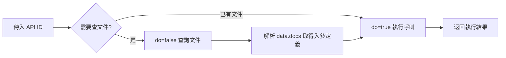

# 工作流



## 第一步

當**首次呼叫**或**不確定入參結構**時，先查詢文件。

### 請求

| 項目   | 值                                |
| ---- | -------------------------------- |
| 介面地址 | `https://abc.feg.com.tw/oauth2/fdep`   |
| 請求方式 | `POST`                           |
| 請求頭  | `Content-Type: application/json` |

```json
{
  "api": "<API_ID>",
  "do": false,
  "inbound": {}
}
```

> 注意：`do: false` 表示僅查詢文件，不執行業務邏輯。`inbound` 傳空物件即可，文件查詢不依賴具體參數。

### 回應

```json
{
  "data": {
    "docs": {
      "desc": "介面功能描述",
      "name": "參數1",
    },
    "flow": "流程圖字串（除錯用，可忽略）"
  },
  "trace_id": "xxx"
}
```

#### docs 欄位解讀規則

- `docs.desc` → 介面功能說明（**不**作為請求參數）
- `docs` 中**除 `desc` 外的其他欄位** → 介面所需的入參欄位名及說明
- 根據欄位名和說明，由使用者或上下文提供對應值

## 第二步：執行 API 呼叫

拿到文件後，按 `docs` 中的欄位（排除 `desc`）組裝 `inbound`。

### 請求
| 項目   | 值                                |
| ---- | -------------------------------- |
| 介面地址 | `https://abc.feg.com.tw/oauth2/fdep`   |
| 請求方式 | `POST`                           |
| 請求頭  | `Content-Type: application/json` |

```json
{
  "api": "<API_ID>",
  "do": true,
  "inbound": {
    "name": "aaa"
  }
}
```

> 關鍵：`inbound` 的鍵名必須與 `docs` 中除 `desc` 外的欄位名完全一致。

## 完整範例

### 場景：呼叫 test.demo 介面

#### 1. 查詢文件

##### 請求：
```json
{
  "api": "test.demo",
  "do": false,
  "inbound": {}
}
```

##### 回應：
```json
{
  "data": {
    "docs": {
      "desc": "最簡單的範例",
      "name": "aaa"
    },
    "flow": "flowchart TD\n  subgraph Flow[\"Flow\"]\n    N2@{ label: '取得資料' }\n  end"
  },
  "trace_id": "f554b70e-cbc7-40f9-b6e5-463e1be02cd9",
  "root_path": ""
}
```

#### 2. 分析文件

從`docs`擷取入參欄位（排除`desc`）：
| 欄位名        | 需提供的值              |
| ---------- | ------------------ |
| `name` | `aaa`         |


#### 3. 執行呼叫

##### 請求：
```json
{
  "api":"test.demo",
  "do":true,
  "inbound": {
    "name":"aaa"
  }
}
```
